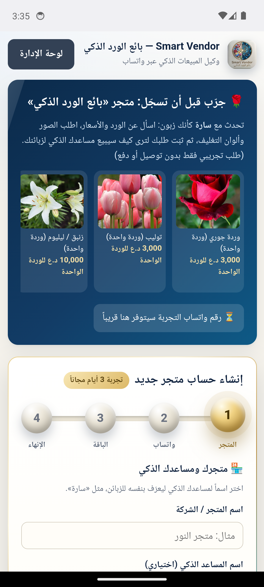

# Smart Vendor — بائع الورد الذكي

**وكيل مبيعات ذكي يرد على زبائنك في واتساب ٢٤ ساعة، ويحوّل المحادثات إلى طلبات مثبّتة.**

### [⬇️ تحميل التطبيق (APK)](https://github.com/SmartVendorTech/smart-vendor/releases/latest/download/SmartVendor.apk)

🌐 الموقع: **[smartvendortech.com](https://smartvendortech.com)** — أو حمّل التطبيق مباشرة من [smartvendortech.com/app/SmartVendor.apk](https://smartvendortech.com/app/SmartVendor.apk)

---

## شنو يسوي التطبيق؟

مساعد ذكي خاص بمتجرك، يشتغل على رقم واتساب متجرك:

- 💬 **يرد على الزبائن فوراً** — بالعربي وباللهجة العراقية، ليل نهار.
- 🖼️ **يرسل صور المنتجات** ويفهم الصور التي يرسلها الزبون.
- 🎤 **يفهم الرسائل الصوتية** ويرد عليها.
- 🧮 **يحسب السعر الكلي** حسب أسعار متجرك، ويسأل الزبون عن اسمه، ويثبّت الطلب بعد تأكيده.
- 🙋 **يحوّل الأسئلة الصعبة لك** — إذا سأل الزبون شيئاً خارج معرفته، يصلك السؤال على واتساب، وجوابك يوصل للزبون.
- 📜 **يلتزم بسياساتك** — تكتب له التعليمات برسالة واتساب (مثلاً: لا تعطِ رقمي لأي زبون) وينفذها دائماً.
- 📊 **تقارير عند الطلب** — اكتب له "دزلي التقرير" ويرسل عدد الزبائن المهتمين ومعلوماتهم بملف Excel.
- 🔔 **متابعة الزبائن** — اطلب منه يراسل زبوناً قديماً ليشوف إذا بعده مهتم.

---

## طريقة التثبيت

التطبيق غير منشور على Google Play بعد، فالتثبيت يتم بتحميل الملف مباشرة. الخطوات:

| | |
|---|---|
| **1** | اضغط على **[⬇️ تحميل التطبيق](https://github.com/SmartVendorTech/smart-vendor/releases/latest/download/SmartVendor.apk)** من هاتفك. |
| **2** | المتصفح يحذرك أن الملف قد يضر بجهازك — اضغط **موافق / تنزيل**. هذا تحذير اعتيادي لأي ملف APK. |
| **3** | افتح الملف بعد التحميل. إذا ظهرت رسالة *"غير مسموح بتثبيت تطبيقات غير معروفة"*، اضغط **الإعدادات** وفعّل الخيار، ثم **رجوع**. |
| **4** | اضغط **تثبيت**، وإذا ظهر تحذير Play Protect اضغط **تثبيت على أي حال**. |

**المتطلبات:** أندرويد 7.0 أو أحدث. حجم التطبيق أقل من 1 ميغابايت.

> التطبيق لا يطلب أي صلاحية حساسة: لا جهات اتصال، لا رسائل، لا موقع. يطلب الوصول للصور فقط عندما ترفع صور منتجاتك بنفسك.

---

## كيف يبدأ متجرك؟

1. ثبّت التطبيق وافتحه.
2. أنشئ حساب متجرك (٤ خطوات: المتجر ← رقم واتساب ← الباقة ← الإنهاء).
3. اختر اسماً لمساعدك الذكي (مثلاً: سارة).
4. أضف منتجاتك وأسعارها وصورها.
5. اربط رقم واتساب المتجر بمسح رمز QR من *الأجهزة المرتبطة*.
6. المساعد يبدأ الرد على زبائنك فوراً.

### قبل ما تشترك — جرّب

تقدر تحادث متجر التجربة **«بائع الورد الذكي»** وتطلب باقة ورد كأنك زبون، حتى تشوف كيف سيبيع مساعدك الذكي لزبائنك. رقم التجربة موجود داخل التطبيق في الصفحة الرئيسية.

---

## الأسعار والاشتراك

الاشتراك شهري حسب عدد زبائنك، ويبدأ من **10,000 دينار عراقي شهرياً** (حتى 300 زبون). الدفع داخل العراق عبر **زين كاش**: تحوّل المبلغ وترفع صورة الوصل من داخل التطبيق، ويُفعَّل متجرك بعد المراجعة. للمتاجر خارج العراق: الدفع بالبطاقة.

---

## الدعم

للأسئلة والمساعدة: راسلنا على واتساب — `+964 000 000 0000`

---

## English

**Smart Vendor** is an AI sales agent for WhatsApp. It answers your customers in Arabic around the clock, sends product photos, understands photos and voice notes, calculates order totals, registers confirmed orders, escalates questions it cannot answer to the shop owner, follows your written policies, and reports interested buyers on request.

Android 7.0+ · under 1 MB · **[Download the APK](https://github.com/SmartVendorTech/smart-vendor/releases/latest/download/SmartVendor.apk)**

